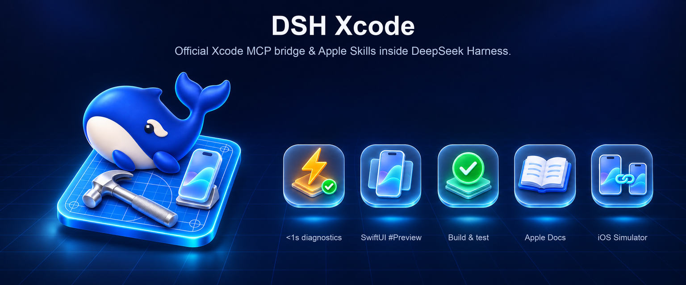

<p align="center">
  
</p>

<h1 align="center">DSH Xcode 工作台</h1>

<p align="center">
  <strong>在 <a href="https://github.com/deepseek-ai/deepseek-harness">DeepSeek Harness</a> 对话中直连 Apple 官方 Xcode MCP 桥接（<code>xcrun mcpbridge</code>）与内置 Apple Skills——并与 <a href="https://github.com/ZSeven-W/dsh-ios">DSH iOS</a> 无缝协同。</strong><br />
  <sub>8 个智能体工具 &bull; &lt; 1 秒单文件编译查错 &bull; 原生 SwiftUI <code>#Preview</code> 快照 &bull; 热缓存增量构建与测试 &bull; 本地 Apple 文档检索 &bull; 右侧栏 Xcode 工作台</sub>
</p>

<p align="center">
  <sub>npm: <code>@zseven-w/dsh-xcode</code> &middot; 当前插件版本：<code>0.1.0-rc.1</code> &middot; 已在 DSH <code>0.2.1-rc.5</code> 验证</sub>
</p>

<p align="center">
  <a href="./README.md">English</a> &middot; <b>简体中文</b>
</p>

<p align="center">
  <a href="https://github.com/ZSeven-W/dsh-xcode/actions/workflows/check.yml"></a>
  <a href="https://www.npmjs.com/package/@zseven-w/dsh-xcode"></a>
  <a href="https://github.com/ZSeven-W/dsh-xcode/blob/main/LICENSE"></a>
</p>

<br />

<p align="center">
  
</p>

## 为什么选择 DSH Xcode

从 Xcode 26.3 起，Apple 在工具链中内置了官方 Model Context Protocol 桥接器（`xcrun mcpbridge`，通过本地 XPC 直连运行中的 Xcode）以及官方 `SKILL.md` 技能导出工具（`xcrun agent skills export`）。但如果直接把裸 `xcrun mcpbridge` 挂进通用 Agent，会遇到三个明显的工程障碍：

1. **Xcode 26 `structuredContent` 协议不一致** — `XcodeListWindows` 等工具在 `tools/list` 中声明了 `outputSchema`，实际返回时却把 JSON 放进 `content[0].text` 且省略 `structuredContent`，导致严格校验 Schema 的标准 MCP 客户端直接报错拒收。
2. **进程生命周期与多开 PID 路由** — Xcode 未打开、同时运行了正式版 `Xcode.app` 与 `Xcode-beta.app`、或尚未在 **Xcode → Settings → Intelligence** 开启外部 Agent 权限时，裸 STDIO 进程会直接退出或抛底层 XPC 错误。
3. **上下文膨胀** — Xcode 原生暴露 20+ 个细粒度工具，且 `RenderPreview` 会返回数 MB 的 Base64 PNG 字符串。

`DSH Xcode` 将 Apple 官方桥接封装为零运行时依赖的原生 DSH 插件，提供常驻右侧栏的 **Xcode 工作台**，并与 [`@zseven-w/dsh-ios`](https://github.com/ZSeven-W/dsh-ios) 实现零耦合双插件联动。

| | |
| --- | --- |
| ⚡ **&lt; 1 秒单文件查错** | `xcode_diagnostics` 传入 `filePath` 时直接调用 `XcodeRefreshCodeIssuesInFile`，复用 Xcode 内存中的增量编译图对单个 Swift/ObjC 文件秒级查错，告别每次编辑都跑冷启动 `xcodebuild`。 |
| 🖼️ **原生 SwiftUI `#Preview` 快照** | `xcode_render_preview` 驱动 Xcode 原生 `RenderPreview` 引擎，同时支持 `.xcodeproj`、`.xcworkspace` 与 Swift Package，快照自动落盘至 `.dsh-xcode/previews/` 并在多模态模型下附带图片上下文。 |
| 🔨 **热缓存增量构建与单测** | `xcode_build_test` 复用 Xcode 热 DerivedData 构建图执行 `BuildProject`、`GetBuildLog`、`GetTestList`、`RunAllTests` 与 `RunSomeTests`（兼容 XCTest 与 Swift Testing）。 |
| 🔧 **Xcode 26 协议兼容与自动路由** | 自动将单块 JSON 文本回填至 `structuredContent`，在多窗口场景下按工程路径自动匹配 `tabIdentifier`，并剥离超大 Base64 字段防止撑爆模型上下文。 |
| 📘 **Apple 官方 `SKILL.md` 同步** | 调用 `xcrun agent skills export` 导出当前 Xcode 版本内置的官方技能包，按编译号缓存至 `~/.cache/dsh-xcode/skills/` 并动态注册进 DSH `ctx.skills`。 |
| 🪟 **右侧栏「Xcode 工作台」** | 实时展示连接状态与 PID、已打开工程窗口、最新编译器报错、最近一次构建/测试摘要、SwiftUI `#Preview` 预览画廊，以及 `dsh-ios` 设备在线状态。 |
| 📱 **与 `dsh-ios` 双剑合璧** | 无任何安装期依赖，同进程通过 `Symbol.for('zseven.dsh.apple.peer.v1')` 自动发现：IDE 编译查错交给 `dsh-xcode`，模拟器/USB 真机实时投屏与无障碍/OCR 交互交给 `dsh-ios`。 |
| 🧭 **面向未来的逃生舱** | `xcode_call_tool` 支持随时列出并调用任意原生 `mcpbridge` 工具（如 `ExecuteSnippet`、`XcodeUpdate` 或 Xcode 27+ 新增的 `DeviceInteraction*`），无需等待插件发版。 |

## 工具列表

全部 8 个工具在任何主机上均会注册；省略 `tabIdentifier` 时自动按当前工作区匹配打开的窗口，非 macOS 主机或未启动 Xcode 时会返回明确的修复指引。

| 工具 | 作用 | 关键参数 |
| --- | --- | --- |
| `xcode_status` | 检查本机 `xcode-select` 路径、Xcode 版本/编译号、`xcrun mcpbridge` 与 `agent` 能力、运行中 `Xcode.app` PID、已打开窗口（`tabIdentifier`）、已同步官方 Skills 及 `dsh-ios` 联动状态。 | `connect`（默认 `true`） |
| `xcode_open_project` | 自动探测并在 Xcode 中打开 `.xcworkspace`、`.xcodeproj` 或 `Package.swift`，轮询等待 `mcpbridge` 就绪并返回对应窗口的 `tabIdentifier`。 | `projectPath`（可选）、`waitSeconds`（默认 `20`） |
| `xcode_diagnostics` | 读取 Xcode 实时编译报错与警告。传 `filePath` 执行 `< 1 秒`单文件查错（`XcodeRefreshCodeIssuesInFile`）；不传则读取全局 Issue Navigator 诊断（`XcodeListNavigatorIssues`）。 | `filePath`、`projectPath`、`tabIdentifier`、`severity`（`error`/`warning`/`remark`）、`pattern` |
| `xcode_build_test` | 复用 Xcode 热构建图编译当前活跃 Scheme、读取过滤后的构建日志，或列出/运行 XCTest 与 Swift Testing 测试。 | `action`（必填——`build`/`build_log`/`list_tests`/`run_all_tests`/`run_some_tests`）、`tests`（JSON 数组）、`severity`、`pattern` |
| `xcode_render_preview` | 在 Xcode 内原生渲染 SwiftUI `#Preview` 或 `PreviewProvider` 快照，保存 PNG 至 `.dsh-xcode/previews/` 供右侧工作台展示，并在多模态模型下附带图片。 | `sourceFilePath`（必填）、`previewDefinitionIndexInFile`（默认 `0`）、`projectPath`、`tabIdentifier` |
| `xcode_search_docs` | 语义检索本地 Xcode 内置的 Apple Developer Documentation 与 WWDC 讲座文稿（`DocumentationSearch`）。 | `query`（必填）、`frameworks`（可选逗号分隔，如 `"SwiftUI,Observation"`） |
| `xcode_sync_skills` | 通过 `xcrun agent skills export` 导出当前 Xcode 内置的 Apple 官方 `SKILL.md` 技能包并注册到当前 DSH 会话。 | — |
| `xcode_call_tool` | 列出当前 Xcode 暴露的所有底层 MCP 工具（`action: "list"`）或直接调用指定底层工具（`action: "call"`）。 | `action`（必填——`list`/`call`）、`toolName`、`argumentsJson` |

## 界面形态

- **右侧栏面板——「Xcode 工作台」。** 点击任意工具行上的 **打开工作台** 按钮，或在右侧栏 **`+`** 启动器中选择 **Xcode 工作台** 即可打开。面板展示 Xcode 连接状态胶囊与 PID、Xcode 版本号、`dsh-ios` 设备联动状态、已打开窗口 `tabIdentifier`、带文件与行号的编译诊断列表、最新构建/测试摘要、SwiftUI `#Preview` 缩略图画廊、已同步 Apple 官方 Skills 及已挂载底层工具清单。顶部工具栏按钮（**刷新状态**、**打开工程**、**检查报错**、**增量编译**、**同步官方 Skills**）通过 `/xcode` 指令直接执行，不消耗模型 Token。
- **紧凑对话行卡片。** 工具调用完成后渲染中英双语紧凑状态行，并在结算时自动通知已打开的工作台标签页刷新状态。

## 与 DSH iOS（`@zseven-w/dsh-ios`）协同

`dsh-xcode` 与 [`@zseven-w/dsh-ios`](https://github.com/ZSeven-W/dsh-ios) **没有任何安装期硬依赖**，可单独使用，也可同时装入同一 DSH Profile。同时挂载时，两者通过同进程 `Symbol.for('zseven.dsh.apple.peer.v1')` 自动协同：

- **`dsh-xcode`（`xcode_*`）负责 IDE 与编译器闭环** — 编辑代码时的 `< 1 秒`单文件查错、热缓存 Scheme 编译与单测、`.xcodeproj` / `.xcworkspace` 原生 SwiftUI `#Preview` 渲染、本地 Apple 文档查询。
- **`dsh-ios`（`ios_sim_*`）负责设备运行时与 UI 自动化** — 模拟器与 USB 真机 iPhone 的实时 MJPEG 视频流面板、AXe 无障碍树（`ios_sim_ui_tree`、`ios_sim_tap_element`、`ios_sim_ui_rows`）、Vision OCR 找字点字（`ios_sim_find_text`、`ios_sim_tap_text`）、统一日志（`ios_sim_logs`）、LLDB 调用栈与 `leaks` 泄漏检测。
- **跨插件智能引导** — 当模型对 `.xcodeproj` / `.xcworkspace` 工程误调仅适用于 Swift Package 的 `ios_sim_preview` 时，`dsh-ios` 会自动识别已挂载的 `dsh-xcode` 并引导模型改用 `xcode_render_preview`。

## 安全与隐私

- **纯本机 XPC 通信** — `xcrun mcpbridge` 仅通过 macOS XPC 与本机运行中的 Xcode 通信，插件不监听任何网络端口，也不发起任何外部网络请求。
- **环境变量脱敏清洗** — 启动 `xcrun mcpbridge` 或 `xcrun agent` 子进程前，`scrubEnvForMcpBridge` 会自动剔除所有名称匹配 `*KEY*`、`*SECRET*`、`*TOKEN*`、`*PASSWORD*` 及 `DSH_*` 的变量，仅保留 macOS 开发与 XPC 必需的基础环境（`HOME`、`USER`、`PATH`、`TMPDIR`、`DEVELOPER_DIR`、`MCP_XCODE_PID`、`MCP_XCODE_SESSION_ID`）。
- **Xcode 原生显式授权** — 外部 Agent 连接受 Xcode 自身的 **Settings → Intelligence → Model Context Protocol** 开关与系统弹窗双重管控。
- **严格二进制边界** — MCP 图片块在解码前会校验标准 Base64 格式与 20 MB 体积上限，JSON 文本中携带的大体积 Base64 字段会被自动剥离。

## 环境要求

- **macOS** + **Xcode 26.3 及以上版本**（`xcode-select -p` 需指向完整 `/Applications/Xcode.app/Contents/Developer`，而非仅安装 Command Line Tools）。
- **DeepSeek Harness** `0.2.1-rc.5` 及以上版本，Node.js `>= 24.11.0`。
- **首次开启权限** — 打开 **Xcode → Settings → Intelligence → Model Context Protocol**，勾选允许外部 Agent（首次连接时在 Xcode 授权弹窗中点击 **Allow**）。

## 安装到 DSH

```sh
dsh plugin --profile web add @zseven-w/dsh-xcode@latest
dsh web
```

推荐同时安装 `dsh-ios`，获得完整的「Xcode IDE 编译诊断 + 模拟器/真机实时画面交互」闭环：

```sh
dsh plugin --profile web add @zseven-w/dsh-ios@latest
```

## 快速上手

1. **检查状态并打开工程** — *“检查一下 Xcode 状态，并打开当前目录里的 iOS 工程。”* → `xcode_status` / `xcode_open_project`（首次运行请在 Xcode 弹窗点击 Allow）。
2. **秒级单文件查错** — *“重构 `HomeView.swift`，先别整编，单文件查一下有没有编译错误。”* → `xcode_diagnostics`（`filePath: "Sources/HomeView.swift"`）。
3. **渲染 SwiftUI `#Preview`** — *“渲染 `HomeView.swift` 的 SwiftUI 预览看看排版。”* → `xcode_render_preview`，点击工具行或右侧栏即可在 **Xcode 工作台** 查看高清预览图。
4. **查文档与跑单测** — *“搜一下本地 Apple 文档里 `NavigationSplitView` 的分栏控制写法，然后跑一遍测试。”* → `xcode_search_docs` → `xcode_build_test`（`action: "run_all_tests"`）。

## 配置项

可在 Profile 的 `cordis.patch.yml` 中 `plugins.dsh-xcode` 下按需设置（全部可选）：

| 配置项 | 默认值 | 说明 |
| --- | --- | --- |
| `xcodePid` | 自动解析 | 同时打开正式版与 Beta 版 Xcode 时，指定需要附着的 Xcode 进程 PID（`MCP_XCODE_PID`）。 |
| `callTimeoutMs` | `180000` | `BuildProject`、`RunAllTests`、`RenderPreview` 等长耗时调用的默认超时毫秒数。 |
| `autoSyncSkills` | `true` | 在 `xcode_status` 或 `xcode_open_project` 连接成功时自动导出并注册 Apple 内置 `SKILL.md` 技能包。 |
| `skillsCacheDir` | `~/.cache/dsh-xcode/skills` | 按 Xcode 编译号缓存官方 `SKILL.md` 的本地目录。 |

## 常见问题排查

- **提示找不到 `mcpbridge` 或指向 Command Line Tools** — 当前 `xcode-select -p` 指向了 `/Library/Developer/CommandLineTools` 或旧版 Xcode（< 26.3）。请执行 `sudo xcode-select -s /Applications/Xcode.app/Contents/Developer` 切换到 Xcode 26.3+。
- **`Could not establish MCP tool session with Xcode`** — 请确认已在 Xcode 中打开至少一个工程窗口（可调用 `xcode_open_project`），在 **Xcode → Settings → Intelligence → Model Context Protocol** 中开启外部 Agent 权限，并留意 Xcode 是否在后台弹出了 Allow 授权框。
- **同时开了多个 Xcode** — 插件默认优先匹配 `xcode-select -p` 对应的 Xcode 路径；若同一路径多开，可在配置中指定 `xcodePid` 或设置环境变量 `DSHPLUGIN_XCODE_PID=<pid>`。
- **复杂 `#Preview` 宏渲染失败** — 部分多 Target 工程中 `#Preview` 宏可能无法自动推断设备形态，在文件中补充标准 `PreviewProvider` 结构体即可稳定通过 `xcode_render_preview` 渲染。

## 本地开发与测试

```sh
pnpm install
pnpm run typecheck
pnpm test
pnpm run smoke:pack
```

以本地目录链接方式挂载到 DSH Web Profile：

```sh
dsh plugin --profile web add link:/path/to/dsh-xcode
dsh web
```

| 测试套件 | 覆盖范围 |
| --- | --- |
| `test/mcp-stdio.test.mjs` | STDIO JSON-RPC 握手、分页 `tools/list`、Xcode 26 省略 `structuredContent` 自动回填、标准 Base64 PNG 解码、大体积 Base64 剥离、环境变量脱敏、错误分类。 |
| `test/env-and-bridge.test.mjs` | `ps` 中 `Xcode.app` 与 `Simulator.app` 进程区分、PID 选择优先级、`.xcworkspace`/`.xcodeproj`/`Package.swift` 探测、`tabIdentifier` 自动匹配、工作台状态持久化、`SKILL.md` 导出与宿主 `apply()` 生命周期。 |
| `test/client-bundle.test.mjs` | `window.__ModuleLoader__.load` 产物形态、外部化宿主 React 校验、`zh`/`en` 词条一致性、工作台资源地址编解码、右侧栏 Tab 与 Slot 注册。 |
| `test/ios-peer-linkage.test.mjs` | 与 `@zseven-w/dsh-ios` 的同进程 `Symbol.for('zseven.dsh.apple.peer.v1')` 实时互通，以及 `.xcodeproj` → `xcode_render_preview` 智能路由提示。 |

## 生态项目（Ecosystem）

- [DSH iOS Simulator](https://github.com/ZSeven-W/dsh-ios) — 在对话中嵌入实时可交互的 iOS 模拟器与 USB 真机画面，支持 AXe 无障碍树、Vision OCR 与 SwiftPM 预览热重载
- [DSH Android](https://github.com/ZSeven-W/dsh-android) — 基于 `adb` 的实时 Android 模拟器与 USB 真机流式交互插件
- [DSH Computer](https://github.com/ZSeven-W/dsh-computer) — macOS 原生桌面 Computer Use 驱动（AX 优先观测 + 宿主审批）
- [DSH Browser](https://github.com/ZSeven-W/dsh-browser) — 隔离式 Chromium 会话自动化、语义引用与有界证据采集
- [DSH QA](https://github.com/ZSeven-W/dsh-qa) — 跨 Browser、Desktop、iOS 与 Android 的智能体探索测试与确定性场景回放
- [DSH Game Studio](https://github.com/ZSeven-W/dsh-game-studio) — 一句话生成可玩的 2D / 3D 体素小游戏，支持侧边栏试玩、AI 换肤与一键发布
- [DSH Harbor](https://github.com/ZSeven-W/dsh-harbor) — 已安装 DSH 插件的能力审计、冲突检测与跨版本升级预检
- [DSH Crew](https://github.com/ZSeven-W/dsh-crew) — 在 Claude Code / Codex 中将任务派发给 DSH 子智能体并行执行
- [DSH Noema](https://github.com/ZSeven-W/dsh-noema) — 可审计的 DSH 持久化长期记忆插件
- [DSH OpenPencil](https://github.com/ZSeven-W/dsh-openpencil) — 在 DSH 对话中预览、审查与编辑 `.op` OpenPencil 设计稿

## 开源协议

MIT © ZSeven-W
